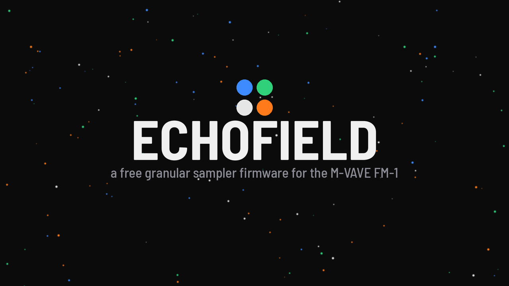
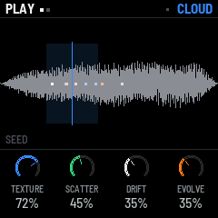
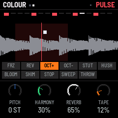
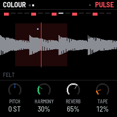
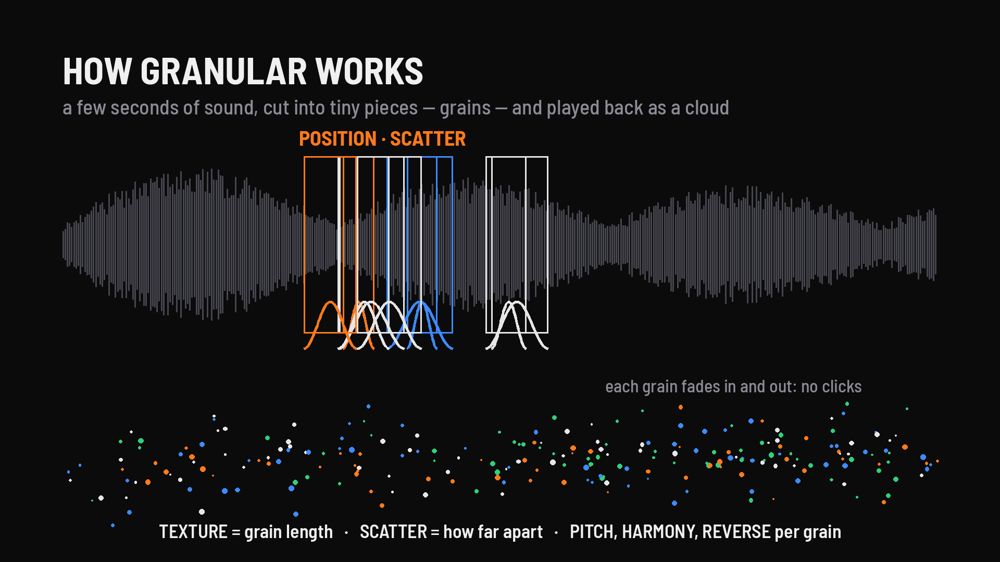
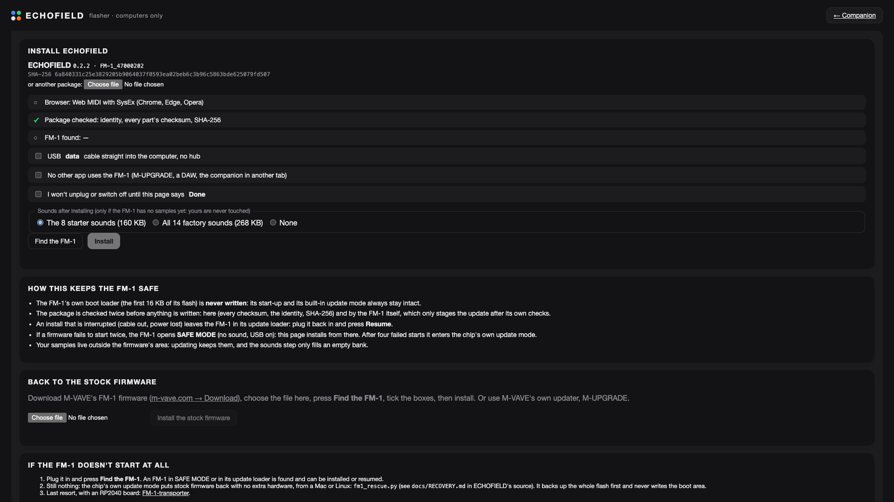
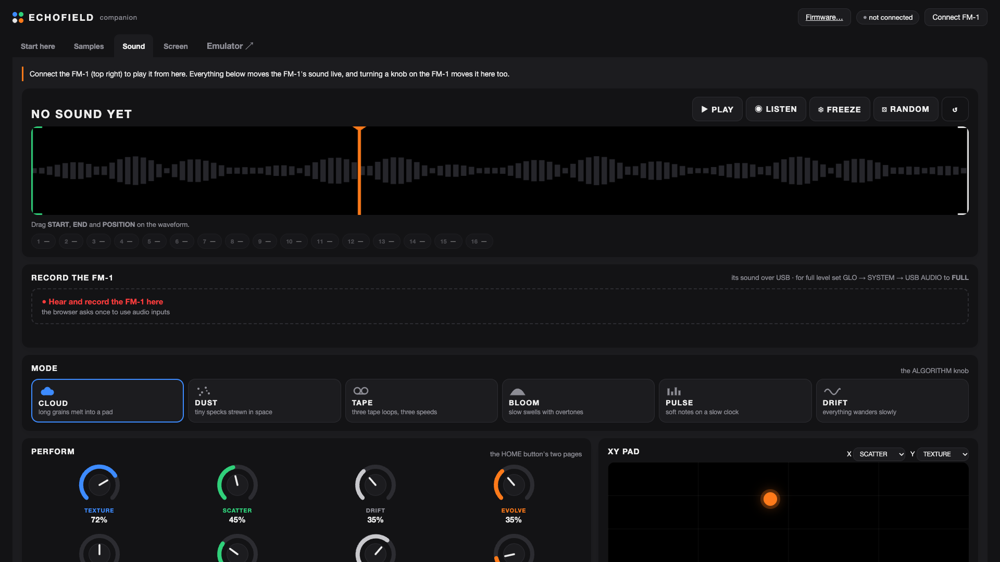
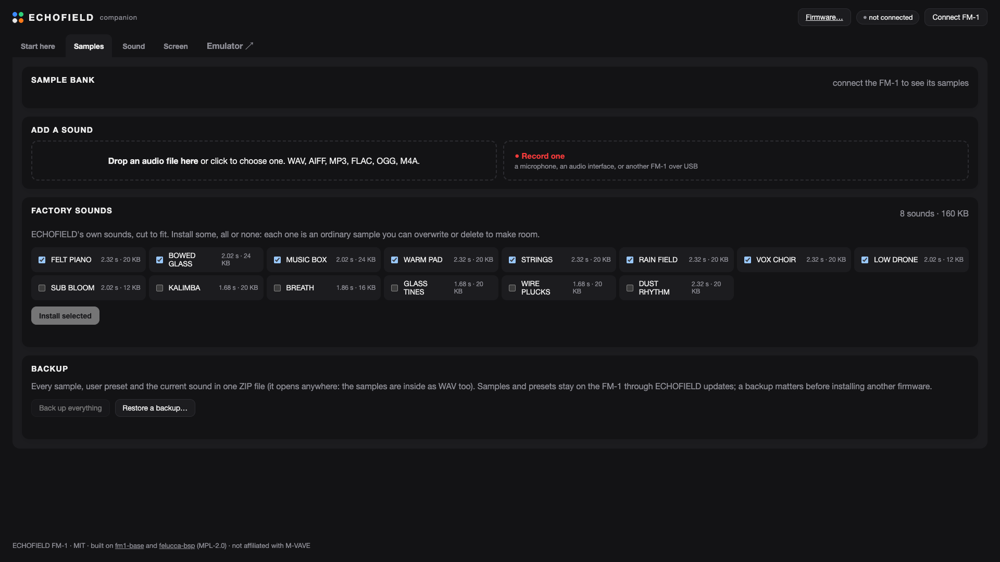
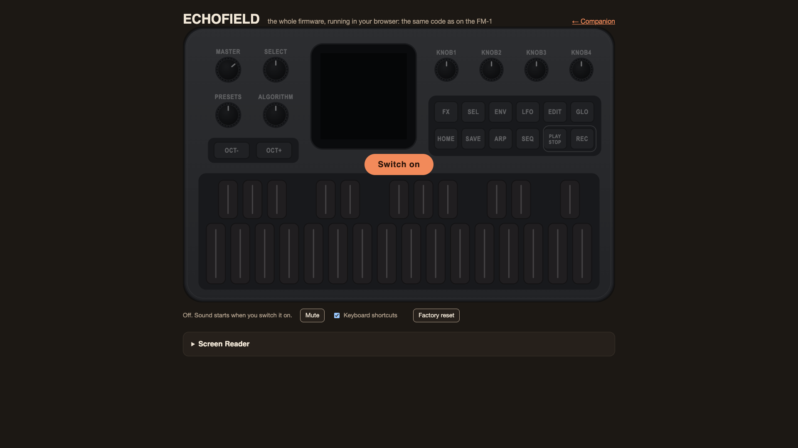

<p align="center"></p>

<p align="center">
  <b>A free, open-source granular sampler firmware for the M-VAVE FM-1</b><br>
  A few seconds of any sound become slow clouds, sparkles, tape loops and swells, played from the FM-1's own keys and knobs.
</p>

<p align="center">
  <a href="https://philip-bos.github.io/echofield-fm1/emulator/"><b>Try it in your browser</b></a> ·
  <a href="https://philip-bos.github.io/echofield-fm1/flasher/"><b>Install it</b></a> ·
  <a href="https://philip-bos.github.io/echofield-fm1/"><b>Companion app</b></a> ·
  <a href="#watch-it">Watch it</a> ·
  <a href="https://discord.gg/nAQmDwytU"><b>Questions? Join the Discord</b></a>
</p>

<p align="center">
  
  
  
</p>

> **New in 0.2.9: follows MIDI clock.** START and STOP from a DAW or another FM-1 start and stop ECHOFIELD, and PULSE
> and the delay lock to the clock's tempo. Every change is in the [changelog](CHANGELOG.md).

---

## What it is

ECHOFIELD turns the M-VAVE FM-1, a tiny FM synth, into a **granular sampler**. It reads tiny pieces of a sample
(grains), dozens at a time, each with its own pitch, place and fade, and overlaps them into a sound that keeps moving.
It started as a granular sampler for the R36S handheld and was rebuilt here, from the ground up, for the FM-1's own
chip.

- **Six modes:** CLOUD, DUST, TAPE, BLOOM, PULSE and DRIFT, each a different way of playing the same sound.
- **Playable:** the keys play the cloud at any pitch, with velocity. Chords work too, and the DRIFT ORACLE picks notes
  in a key you choose.
- **Performance effects:** hold **FX** and the black keys become freeze, reverse, octaves, stutter, tape stop, delay
  throw, shimmer and more, for as long as you hold them.
- **RANDOM with locks:** **ARP** rolls new settings that still sound good. Lock the knobs you love, and undo if you went
  too far.
- **RESAMPLE:** record up to five seconds of what you hear into a new sound, then granulate that.
- **LISTEN:** hear any sample as it is, before the grains change it.
- **14 factory sounds,** all CC0, and 16 slots for your own.
- **Both of the FM-1's cores** render the grains, so there are no dropouts when you play hard.

<p align="center"></p>

## Watch it

A video tour, with the sounds, is on **[philipsknobs](https://www.youtube.com/@philipsknobs)** on YouTube.

## Get started

ECHOFIELD comes with three web apps. They need nothing installed: open them in **Chrome, Edge or Opera**, which can
talk to the FM-1 over USB (Web MIDI).

| | | |
| --- | --- | --- |
| **[Emulator](https://philip-bos.github.io/echofield-fm1/emulator/)** | the whole firmware in your browser, on a drawn FM-1, with the factory sounds | no FM-1 needed |
| **[Flasher](https://philip-bos.github.io/echofield-fm1/flasher/)** | installs and updates ECHOFIELD, puts the factory sounds on, or goes back to the stock firmware | computers only |
| **[Companion](https://philip-bos.github.io/echofield-fm1/)** | the manual, your samples, recording, the sound editor and the FM-1's screen mirror | phones and tablets too |

**To install:** open the flasher on a computer and plug in the FM-1 with a USB data cable. Press **Find the FM-1**, tick
the three boxes and press **Install**. It takes about a minute, and the factory sounds go on afterwards.

<p align="center"></p>

### Is it safe?

Installing goes through the same path as the other FM-1 firmwares built on fm1-base and felucca-bsp:
- **The boot area is never written,** so the FM-1's start-up and its built-in update mode always survive.
- **The package is checked twice:** by the flasher (identity, every part's checksum, the release's SHA-256) and by the
  FM-1 itself, before anything is written.
- **An interrupted install resumes:** plug the FM-1 back in and press Find the FM-1 again.
- **Failed starts are caught:** after two, the FM-1 opens SAFE MODE with USB working; after four, the chip's own update
  mode.
- **Phones and tablets can't install,** because an install there is too easy to interrupt.
- **Going back is one page away:** the stock firmware is on the same page, and M-VAVE's own M-UPGRADE works too.
- **Other firmwares install straight over it,** from [The Firmware Hub](https://thefirmwarehub.com) or their own
  pages: the package carries felucca-bsp's update loader. ECHOFIELD keeps its own sample bank and does not read other
  firmwares' projects or samples (bring sounds in as audio files through the companion).

If anything goes wrong, see [docs/RECOVERY.md](docs/RECOVERY.md).

From the command line instead:

```bash
pip install mido python-rtmidi
python3 tools/flash.py --sounds starter        # or: all, none
```

## Playing it

The four knobs at the top right are the page's four parameters, coloured like the dials on the screen. Press **PLAY**
for the endless sound, or play the keys: C4 is the sample's own pitch. **Hold HOME** on any page and the screen
explains it.

| | |
| --- | --- |
| **SELECT** | the playhead's position in the sample |
| **ALGORITHM** | the mode: CLOUD, DUST, TAPE, BLOOM, PULSE, DRIFT |
| **PRESETS** | browse the presets; the one you stop on loads |
| **HOME ENV LFO FX SEL EDIT GLO SAVE** | pages of knobs; press again for the group's next page |
| **PLAY** · **REC** · **SEQ** | the endless sound · RESAMPLE · FREEZE |
| **ARP** | RANDOM for this page (hold: everything); hold **ARP** and turn a knob to lock it |
| **OCT-** · **OCT+** | the keys' octave; both together undo RANDOM |
| **FX** + a black key | a performance effect while held |
| **EDIT** + a white key | sample 1–16, heard as it is while you hold the key |
| **SAVE** + a white / black key | your preset 1–16 / a factory preset |
| **SEL** + any key | the DRIFT ORACLE's key |
| **EDIT**, then **EDIT** again | LISTEN: the sample, plain |

The companion's **Start here** page has the full manual, with the firmware's own screens and the MIDI CC map.

## The companion app

<p align="center">
  
</p>

| | |
| --- | --- |
| **Start here** | a quick start and the manual |
| **Samples** | the sample bank. Drop in any audio file, or **record one** from a microphone, an audio interface or another FM-1 (one running Sloop, say). Trim it, hear it exactly as the FM-1 will play it, then send it. Rename, delete, export as WAV, install factory sounds, back up and restore |
| **Sound** | everything at once, live in both directions: the sample's waveform with START, END and the playhead to drag, the modes, big knobs, an XY pad, every effect. **Record the FM-1**: monitor its sound and record takes as 24-bit WAV files |
| **Screen** | the FM-1's screen mirrored pixel for pixel, its panel playable from the computer, PNG screenshots |

<p align="center">
  
  
</p>

### Running it yourself

The apps are static files in [`companion/`](companion/). Put the folder on any https site, or serve it on your own
computer:

```bash
python3 companion/serve.py        # http://localhost:8747
```

## Your own sounds

The FM-1 has 1 MiB of flash, most of it the firmware's. ECHOFIELD keeps samples in the rest: **92 sectors, 368 KB**,
packed four to one (IMA ADPCM) at the rate you pick for each sample.

| Rate | Character | The whole bank holds |
| --- | --- | --- |
| 32 kHz | brightest | 21 s |
| 22 kHz | clear | 31 s |
| 16 kHz | warm, the usual | 43 s |
| 11 kHz | lo-fi | 62 s |

A few seconds is all a granular sound needs. The companion's encoder looks ahead for a cleaner result than plain
IMA ADPCM, and you hear exactly what the FM-1 will play before you send it.
- **Samples survive firmware updates** and are checked at every start; a damaged one is never played.
- **The factory sounds are ordinary samples:** delete them whenever you need the room.
- **It always plays:** with an empty bank, ECHOFIELD makes a sound of its own.

## How it works

The engine ([`app/dsp/engine.c`](app/dsp/engine.c)) reads its grains straight from the flash, up to 32 at once, in
integer arithmetic. The odd grains render on the FM-1's second core while the first core renders the even ones. The
hot loops run from RAM, out of the flash cache's way. Effects come after the grains:
- **Tape:** wow, flutter, saturation, wear and hiss.
- **Filter and drive:** a state-variable filter.
- **Delay and reverb:** a 1-second ping-pong delay and an 8-line reverb with shimmer.
- **Output:** width, a slow auto-level, a limiter, and a stereo-width limiter that keeps the FM-1's headphone output
  clean at full volume.

Samples are stored in their own format, built so any block decodes on its own and can't be mistaken for an update
record. The companion talks to the FM-1 over SysEx on fm1-base's framing.

[DESIGN.md](DESIGN.md) has the details: the flash map, the sample format, the protocol and the diagnostics.

## Building from source

What you need:
- the JieLi toolchain and AC79 SDK: `base/tools/get_toolchain.sh`, see [fm1-base](https://github.com/charlesvestal/fm1-base);
- Docker, on macOS;
- Python 3;
- Node.js.

```bash
git clone --recursive https://github.com/Philip-Bos/echofield-fm1
cd echofield-fm1
python3 -m venv .venv && .venv/bin/pip install Pillow fonttools
tools/run_tests.sh                          # every test; no FM-1 needed
python3 base/tools/build.py app             # the firmware: app/build/echofield.fwsc
python3 base/tools/build.py app --host      # the app in fm1-base's FM-1 simulator
tools/release.sh 0.2.8                      # tests, release build, emulator, the companion's package, dist/
```

The tests cover:
- the engine: every mode, extremes, the effects, NaN, levels, DC, bounds, with sanitizers;
- the codec: the encoder bit for bit against the firmware's decoder;
- the app in the FM-1 simulator: the bank, sessions across reboots, presets, RESAMPLE, a full bank;
- the companion's protocol client against the FM-1's own protocol code;
- the screen mirror, pixel for pixel;
- the flasher, which refuses phones and tablets;
- recording in a real browser.

### Layout

| | |
| --- | --- |
| [`app/dsp/`](app/dsp) | the engine: grains, modes, the DRIFT ORACLE, effects; the sample decoder |
| [`app/`](app) | the panel and screens, the sample bank, presets and settings, the USB protocol |
| [`app/tests/`](app/tests) | the tests |
| [`companion/`](companion) | the web apps: companion, `flasher/`, `emulator/` |
| [`tools/`](tools) | tests, releases, flashing from the command line, the parameter table and the factory sounds |
| [`docs/`](docs) | recovery, hardware test notes, screenshots |
| `base/` | [fm1-base](https://github.com/charlesvestal/fm1-base), a pinned git submodule, with felucca-bsp in `base/bsp` |

## Credits

ECHOFIELD stands on other people's work:

- **[fm1-base](https://github.com/charlesvestal/fm1-base)** by **Charles Vestal**: the FM-1 platform (screen, panel,
  audio, MIDI, storage, safe mode, the second core, the screen mirror, backup, the simulator and emulator, the build
  and package tools). The companion's installer, port-finding and mirror code are fm1-base's, unchanged. MPL-2.0.
- **[felucca-bsp](https://github.com/hugelton/felucca-bsp)** by **Leo Kuroshita** (Hügelton Instruments): the chip and
  board support, the update loader and the rescue tools that make installing safe. MPL-2.0.
- **[FM-1-transporter](https://github.com/kurogedelic/FM-1-transporter)** by **Leo Kuroshita**: the last-resort
  recovery path.
- **MIDI Master** (FM-1 Relay contributors, MIT): its way of recording an FM-1's USB audio in the browser, which the
  companion's recording follows.
- **Felucca, SLOOP, JIANT, Skiff and Melodee:** other FM-1 firmwares, studied for their design choices; none of their
  code is in ECHOFIELD. Melodee showed how the second core could be used.
- **The FM-1's font:** [Barlow](https://github.com/jpt/barlow) by Jeremy Tribby, SIL OFL 1.1, via fm1-base.

ECHOFIELD itself, its engine, the companion and the factory sounds are by **Philip Bos**.

## Questions and ideas

Got a question, found a bug, or made something with ECHOFIELD? Come and say hi on the
**[Discord](https://discord.gg/nAQmDwytU)**. Bugs can also go in this repository's
[issues](https://github.com/Philip-Bos/echofield-fm1/issues).

## Licence

ECHOFIELD and its companion are **MIT** ([LICENSE](LICENSE)). The factory sounds are **CC0**. fm1-base and felucca-bsp
are MPL-2.0. [LICENSING.md](LICENSING.md) says which licence covers which file.

*M-VAVE and FM-1 are trademarks of their owners. ECHOFIELD is an independent project, not affiliated with or endorsed
by M-VAVE. Custom firmware is installed at your own risk.*
